# ShopFast – High-Availability Web Service with Load Balancing

| | |
|---|---|
| **Name** | Jubayer Hossen |
| **Course** | DevOps Batch 14 – Cloud & DevOps: Load Balancing |
| **Chosen option** | ✅ **Option A – AWS Application Load Balancer** |
| **AWS Region** | `eu-north-1` (Europe – Stockholm) |
| **Availability Zones** | `eu-north-1a` (AZ-A) and `eu-north-1b` (AZ-B) |
| **Application** | Django 5 + gunicorn on Ubuntu 26.04 LTS (port 8000) |

> **Security note:** no AWS access keys, passwords or private keys are stored in this repository. All resources were deleted after the screenshots were taken (see [Section 9 – Cleanup](#9-cleanup)).

---

## Table of contents

1. [Architecture (Problem 1)](#1-architecture-problem-1)
2. [Repository layout](#2-repository-layout)
3. [Step-by-step build guide](#3-step-by-step-build-guide)
   - [Step 1 – VPC and subnets](#step-1--vpc-and-subnets)
   - [Step 2 – Security groups](#step-2--security-groups)
   - [Step 3 – EC2 instances (Problem 2)](#step-3--ec2-instances-problem-2)
   - [Step 4 – Temporary NAT gateway](#step-4--temporary-nat-gateway-internet-only-for-installation)
   - [Step 5 – EC2 Instance Connect Endpoint](#step-5--ec2-instance-connect-endpoint-ssh-into-private-servers)
   - [Step 6 – Install the Django application](#step-6--install-the-django-application-problem-2)
   - [Step 7 – Target group and health check](#step-7--target-group-and-health-check)
   - [Step 8 – Application Load Balancer (Problem 3)](#step-8--application-load-balancer-problem-3)
4. [Health checks (Problem 4)](#4-health-checks-problem-4)
5. [Failure testing and proof of work (Problem 5)](#5-failure-testing-and-proof-of-work-problem-5)
6. [Reflection (Problem 6)](#6-reflection-problem-6)
7. [Resource ID reference](#7-resource-id-reference)
8. [Troubleshooting notes](#8-troubleshooting-notes)
9. [Cleanup](#9-cleanup)

---

## 1. Architecture (Problem 1)

### 1.1 Diagram

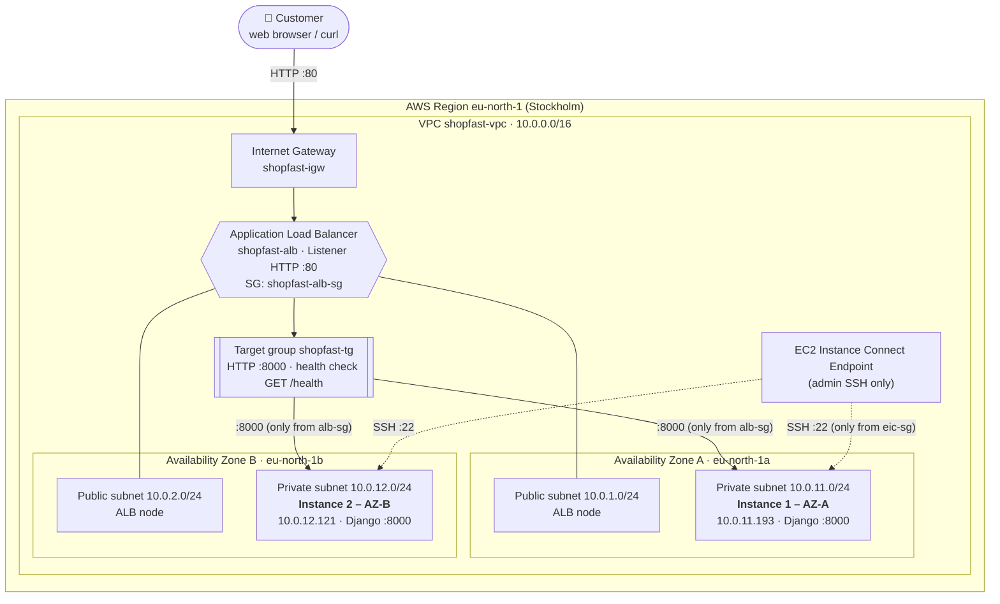

Simplified text version:

```
                        Internet (customers)
                               │ HTTP :80
                     ┌─────────▼──────────┐
                     │  Internet Gateway  │
                     └─────────┬──────────┘
          ┌────────────────────▼─────────────────────┐
          │  Application Load Balancer  shopfast-alb │  (nodes in BOTH public subnets)
          └──────────┬──────────────────────┬────────┘
       eu-north-1a   │ :8000                │ :8000   eu-north-1b
   ┌─────────────────▼───────┐   ┌──────────▼──────────────┐
   │ Public  10.0.1.0/24     │   │ Public  10.0.2.0/24     │
   ├─────────────────────────┤   ├─────────────────────────┤
   │ Private 10.0.11.0/24    │   │ Private 10.0.12.0/24    │
   │ Instance 1 – AZ-A       │   │ Instance 2 – AZ-B       │
   │ 10.0.11.193  (no pub IP)│   │ 10.0.12.121 (no pub IP) │
   └─────────────────────────┘   └─────────────────────────┘
```

### 1.2 Role of each component

| Component | Role in the design |
|---|---|
| **Customer** | Opens `http://shopfast-alb-509413098.eu-north-1.elb.amazonaws.com`. Never talks to a server directly. |
| **Internet Gateway** (`shopfast-igw`) | Connects the VPC to the internet. Only the **public** subnets have a route to it. |
| **Application Load Balancer** (`shopfast-alb`) | The **only public entry point**. Internet-facing, with one node in each public subnet (one per AZ). Listens on HTTP :80 and forwards to the target group. If one AZ fails, the node in the other AZ keeps working. |
| **Listener** (HTTP :80) | Rule that says "every request on port 80 → forward to `shopfast-tg`". |
| **Target group** (`shopfast-tg`) | List of backend servers (the 2 instances on port 8000) plus the **health check**. The ALB only sends traffic to targets marked *healthy*. |
| **Health check** (`GET /health`) | Every 10 s the ALB calls `/health` on each instance. 2 failures → *unhealthy* (removed). 2 successes → *healthy* (added back). |
| **Instance 1 – AZ-A** / **Instance 2 – AZ-B** | t3.micro EC2, Ubuntu 26.04, running Django with gunicorn on port 8000. One per AZ, so a whole-AZ outage leaves one server running. |
| **Private subnets** | Hold the instances. No public IP and no route to the internet, so users cannot reach the servers directly. |
| **Security groups** | Firewalls. They enforce "users → ALB only → instances" (details below). |
| **EC2 Instance Connect Endpoint** | Lets the administrator open an SSH terminal on the private servers from the AWS console without giving them a public IP or a bastion host. |
| **S3 Gateway Endpoint** | Free endpoint created with the VPC. Lets private subnets reach Amazon S3 without internet. |
| **NAT Gateway** (temporary) | Used for about one hour **only to download Django/pip packages**, then deleted (it costs money). |

### 1.3 Network design – VPC, subnets, AZs

| Item | Name | ID | CIDR / value | AZ |
|---|---|---|---|---|
| VPC | `shopfast-vpc` | `vpc-00398e7228a5c298b` | 10.0.0.0/16 | – |
| Public subnet A | `shopfast-subnet-public1-eu-north-1a` | `subnet-06e6d5bd5f0e3953a` | 10.0.1.0/24 | eu-north-1a |
| Public subnet B | `shopfast-subnet-public2-eu-north-1b` | `subnet-02b8f188815fae426` | 10.0.2.0/24 | eu-north-1b |
| Private subnet A | `shopfast-subnet-private1-eu-north-1a` | `subnet-0b5058c7a533e61d3` | 10.0.11.0/24 | eu-north-1a |
| Private subnet B | `shopfast-subnet-private2-eu-north-1b` | `subnet-0205e3c8ee44346e0` | 10.0.12.0/24 | eu-north-1b |
| Public route table | `shopfast-rtb-public` | – | `0.0.0.0/0 → igw` | – |
| Private route table A | `shopfast-rtb-private1-eu-north-1a` | `rtb-000ae49d4688c2c21` | local only (+ S3 endpoint) | eu-north-1a |
| Private route table B | `shopfast-rtb-private2-eu-north-1b` | `rtb-09af80a11791da28f` | local only (+ S3 endpoint) | eu-north-1b |

**What is `10.0.0.0/16`?** It is the private address range of the VPC. `/16` means the first 16 bits (`10.0`) are fixed, so the VPC owns `10.0.0.0 – 10.0.255.255` (65,536 addresses). Each subnet is a smaller `/24` slice (256 addresses, 5 reserved by AWS). `10.x.x.x` is one of the three private ranges defined by RFC 1918 (`10.0.0.0/8`, `172.16.0.0/12`, `192.168.0.0/16`) that are never routed on the public internet.

### 1.4 Security groups

| Security group | ID | Attached to | Inbound rules | Why |
|---|---|---|---|---|
| `shopfast-alb-sg` | `sg-06b003ad81e84d5d0` | ALB | HTTP **80** from `0.0.0.0/0` | Customers anywhere can reach the load balancer. |
| `shopfast-web-sg` | `sg-082c573497ab2cb99` | Both EC2 instances | TCP **8000** from `shopfast-alb-sg` · SSH **22** from `shopfast-eic-sg` | App port opens **only to the ALB**; SSH only through the connect endpoint. |
| `shopfast-eic-sg` | `sg-0f0fe8a89968aaf7f` | EC2 Instance Connect Endpoint | *none* | It only makes outbound connections to the servers. |

Using a **security group as the source** (instead of an IP address) means "allow anything that has this security group attached". Only the ALB has `shopfast-alb-sg`, so only the ALB can reach port 8000. Combined with private subnets and no public IPs, this satisfies *"instances only accept web traffic through the load balancer"*.

---

## 2. Repository layout

```
.
├── README.md       ← this document
└── Screenshots/    ← 46 screenshots, numbered in the order they were taken
```

---

## 3. Step-by-step build guide

Everything was done in the **AWS Management Console** (web browser) plus **AWS CloudShell** for the curl tests. Region selected in the top-right corner: **Europe (Stockholm) eu-north-1**.

> 💡 **Golden rule learned the hard way:** on *every* AWS form that has a **VPC** dropdown, select **`shopfast-vpc`** first. The console often pre-selects the default VPC, and then your subnets and security groups are missing from the lists.

### Step 1 – VPC and subnets

**Console path:** VPC → *Create VPC* → **VPC and more**

| Field | Value |
|---|---|
| Name tag auto-generation | `shopfast` |
| IPv4 CIDR | `10.0.0.0/16` |
| IPv6 | No IPv6 CIDR block |
| Tenancy | Default |
| Number of AZs | **2** → `eu-north-1a`, `eu-north-1b` |
| Public subnets | **2** → `10.0.1.0/24`, `10.0.2.0/24` |
| Private subnets | **2** → `10.0.11.0/24`, `10.0.12.0/24` |
| NAT gateways | **None** (costs money; added temporarily later) |
| VPC endpoints | S3 Gateway (default, free) |
| DNS hostnames / resolution | both enabled |

"VPC and more" creates the VPC, 4 subnets, the internet gateway and the route tables in one go.


*Fig 1 – VPC creation form: 2 AZs, 2 public + 2 private subnets, no NAT.*

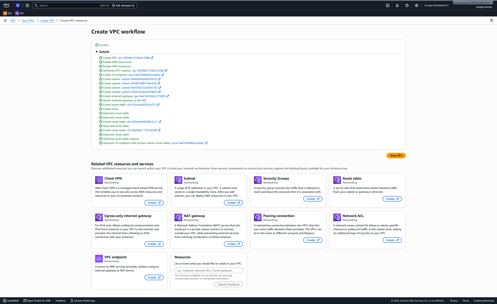
*Fig 2 – All resources created (VPC, subnets, IGW, route tables, S3 endpoint).*

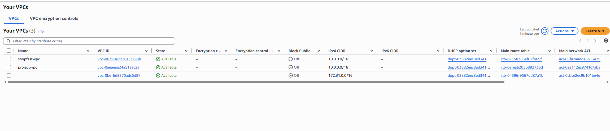
*Fig 3 – `shopfast-vpc` (`vpc-00398e7228a5c298b`, 10.0.0.0/16) in the VPC list.*

### Step 2 – Security groups

**Console path:** EC2 (or VPC) → Security Groups → *Create security group*

**2a. `shopfast-alb-sg`** – VPC `shopfast-vpc`, description *Allow HTTP from internet to ALB*, inbound **HTTP 80 from Anywhere-IPv4**.

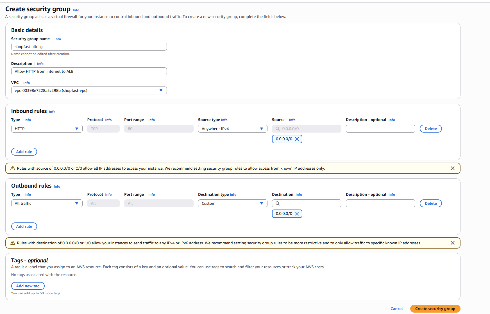
*Fig 4 – ALB security group form.*

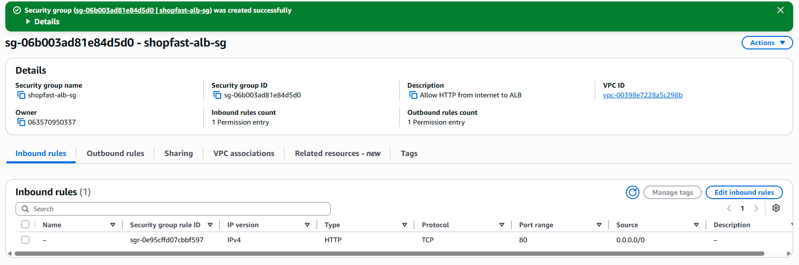
*Fig 5 – `shopfast-alb-sg` created: HTTP 80 ← 0.0.0.0/0.*

**2b. `shopfast-web-sg`** – VPC `shopfast-vpc`, description *Allow Application only from ALB*, inbound **Custom TCP 8000**, source = **`shopfast-alb-sg`** (chosen from the dropdown, not typed).

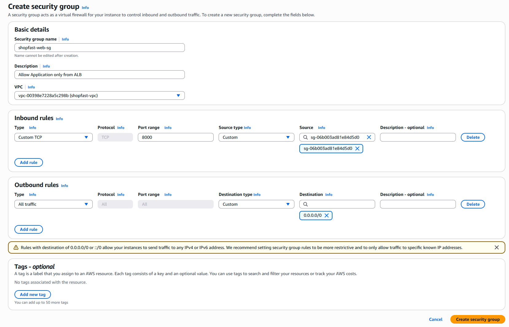
*Fig 6 – Web security group form: port 8000, source = ALB security group.*

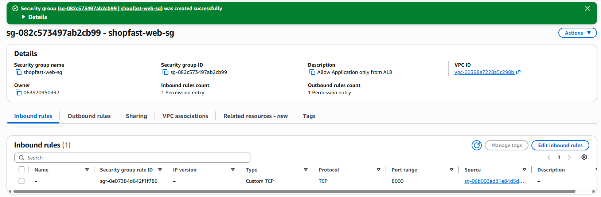
*Fig 7 – `shopfast-web-sg` created: TCP 8000 ← `sg-06b003ad81e84d5d0`.*

**2c. `shopfast-eic-sg`** – VPC `shopfast-vpc`, description *EC2 Instance Connect Endpoint*, **no inbound rules**.

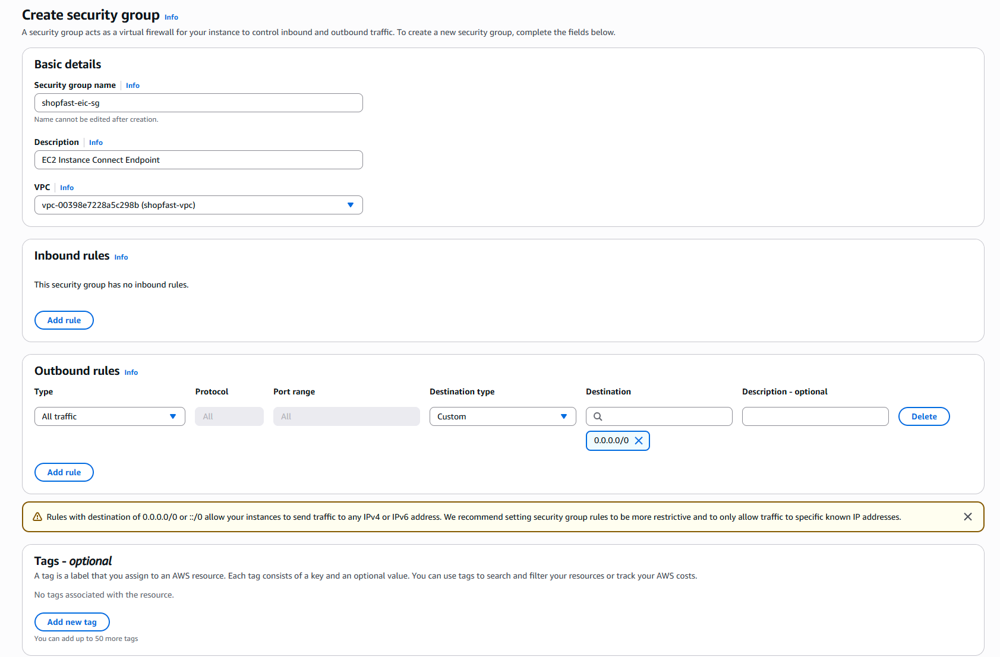
*Fig 8 – Security group for the Instance Connect Endpoint (no inbound rules).*

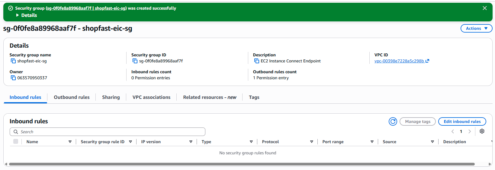
*Fig 9 – `shopfast-eic-sg` created.*

**2d. Allow SSH into the servers only from the endpoint** – `shopfast-web-sg` → *Edit inbound rules* → *Add rule* → **SSH 22**, source = **`shopfast-eic-sg`** → *Save*.


*Fig 10 – Adding SSH 22 from `shopfast-eic-sg` to the web security group.*


*Fig 11 – `shopfast-web-sg` final rules: 8000 ← ALB SG, 22 ← EIC SG.*

### Step 3 – EC2 instances (Problem 2)

**Console path:** EC2 → Instances → *Launch instances* (done twice)

| Setting | Instance 1 | Instance 2 |
|---|---|---|
| Name | `shopfast-instance-1-az-a` | `shopfast-instance-2-az-b` |
| AMI | Ubuntu Server 26.04 LTS | Ubuntu Server 26.04 LTS |
| Instance type | t3.micro (free-tier eligible in Stockholm) | t3.micro |
| Key pair | *Proceed without a key pair* | *Proceed without a key pair* |
| VPC | `shopfast-vpc` | `shopfast-vpc` |
| Subnet | `shopfast-subnet-private1-eu-north-1a` | `shopfast-subnet-private2-eu-north-1b` |
| Auto-assign public IP | **Disable** | **Disable** |
| Security group | `shopfast-web-sg` | `shopfast-web-sg` |
| Result | `i-0aa7818e0410b21fb` · 10.0.11.193 | `i-077de29ff43e54f81` · 10.0.12.121 |

No key pair is needed, because the EC2 Instance Connect Endpoint pushes a temporary SSH key for every session.

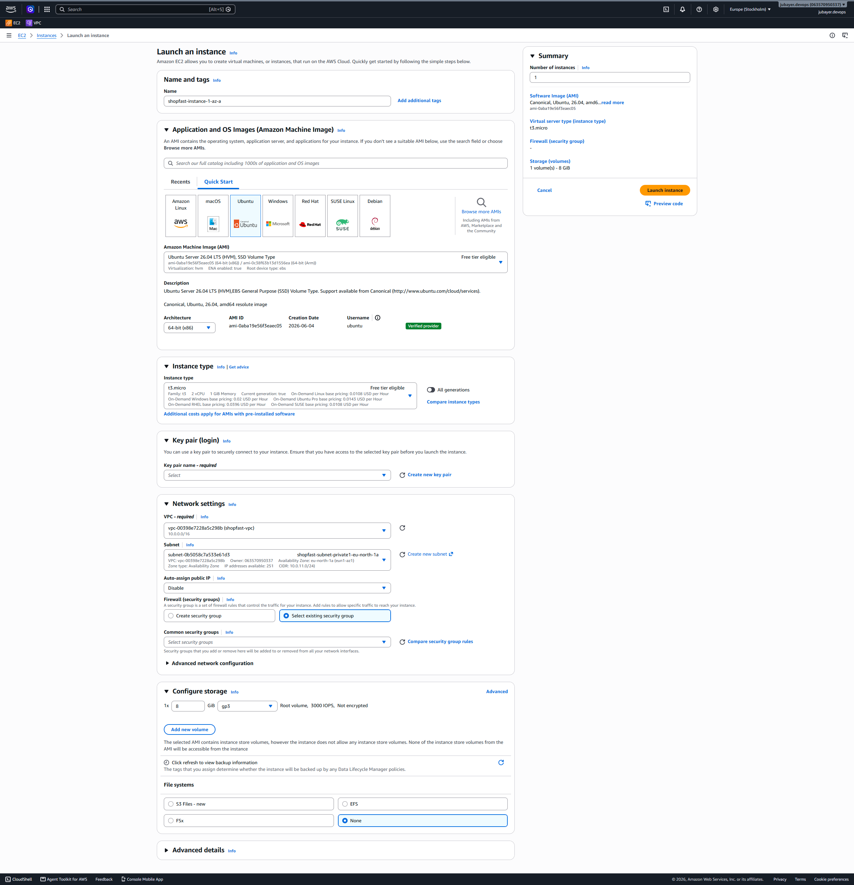
*Fig 12 – Launch form for Instance 1 (private1 subnet, eu-north-1a, no public IP).*

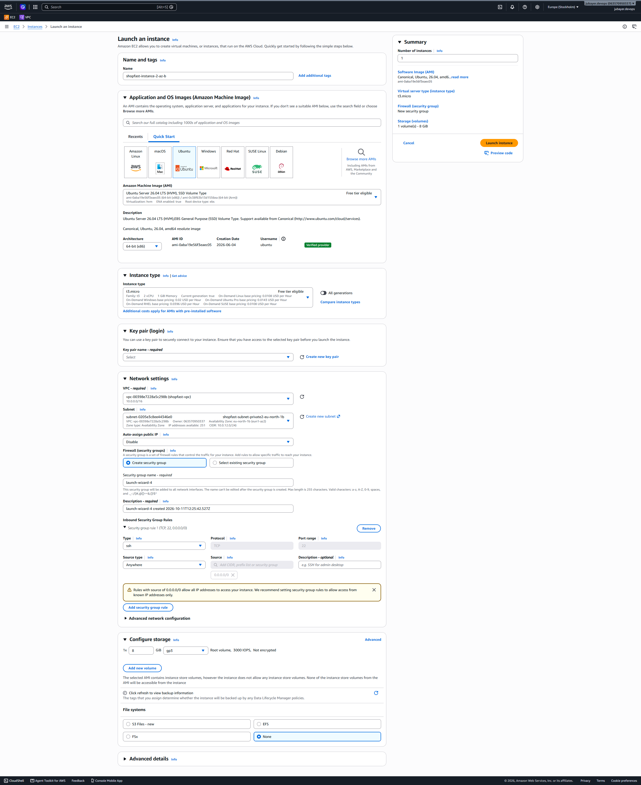
*Fig 13 – Launch form for Instance 2 (private2 subnet, eu-north-1b, no public IP).*

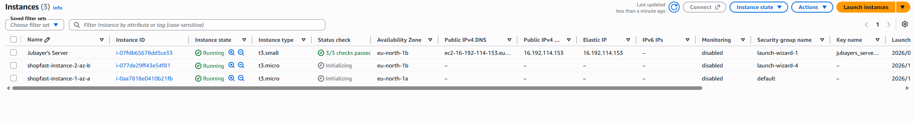
*Fig 14 – First launch: the instances got the wrong security groups (`default` and `launch-wizard-4`). Fixed in the next step.*

**Fixing the security groups without relaunching:** select instance → *Actions → Security → Change security groups* → remove the wrong group → add `shopfast-web-sg` → *Save*.

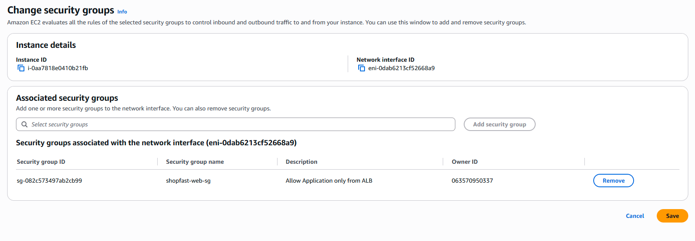
*Fig 15 – Instance 1 now uses only `shopfast-web-sg`.*

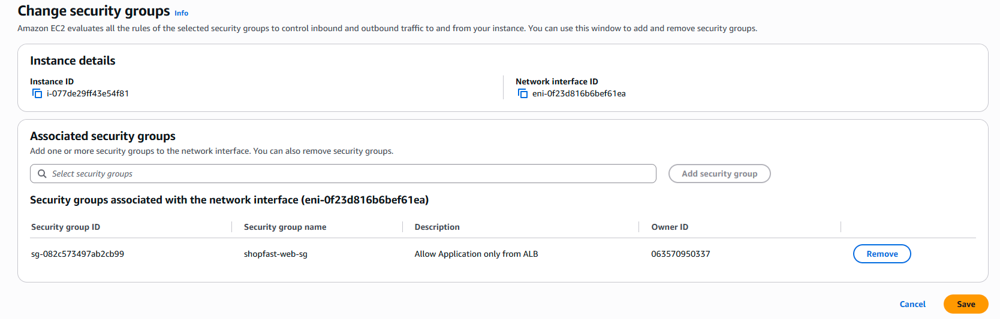
*Fig 16 – Instance 2 now uses only `shopfast-web-sg`.*

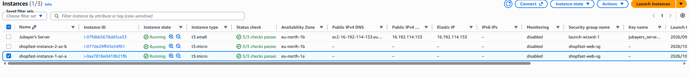
*Fig 17 – Both instances Running, 3/3 checks passed, one in each AZ, **no public IP**, security group `shopfast-web-sg`.*

### Step 4 – Temporary NAT gateway (internet only for installation)

The servers are private, so they cannot download Django from PyPI. A NAT gateway gives **outbound-only** internet access (nobody can connect *in* through it). It was kept for about one hour and then deleted.

**Console path:** VPC → NAT gateways → *Create NAT gateway*

| Field | Value |
|---|---|
| Name | `shopfast-nat-gateway` |
| Availability mode | Zonal |
| Subnet | **`shopfast-subnet-public1-eu-north-1a`** (must be a *public* subnet) |
| Connectivity type | Public |
| Elastic IP | *Allocate Elastic IP* → 13.50.255.219 |


*Fig 18 – NAT gateway in the public subnet with a new Elastic IP.*

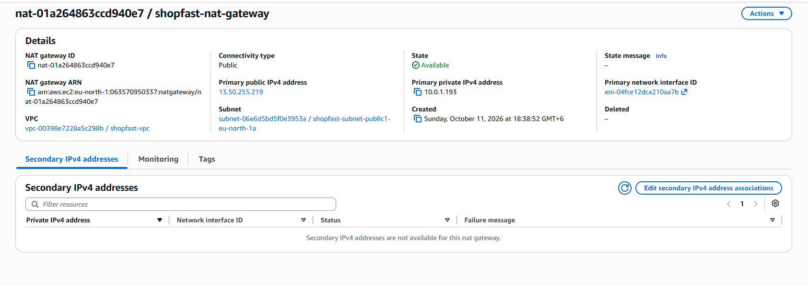
*Fig 19 – `nat-01a264863ccd940e7` is Available.*

Then each private route table gets a default route to the NAT: VPC → Route tables → select table → *Routes → Edit routes → Add route* → `0.0.0.0/0` → *NAT Gateway* → `nat-01a264863ccd940e7` → *Save*.


*Fig 20 – Adding `0.0.0.0/0 → NAT` to private route table A.*


*Fig 21 – Private route table A: local, S3 endpoint, NAT.*


*Fig 22 – Same for private route table B.*


*Fig 23 – Private route table B updated.*

### Step 5 – EC2 Instance Connect Endpoint (SSH into private servers)

**Console path:** VPC → Endpoints → *Create endpoint*

| Field | Value |
|---|---|
| Name | `shopfast-eic-endpoint` |
| Type | **EC2 Instance Connect Endpoint** |
| VPC | `shopfast-vpc` |
| Security group | `shopfast-eic-sg` |
| Subnet | `shopfast-subnet-private1-eu-north-1a` (one endpoint reaches both AZs) |

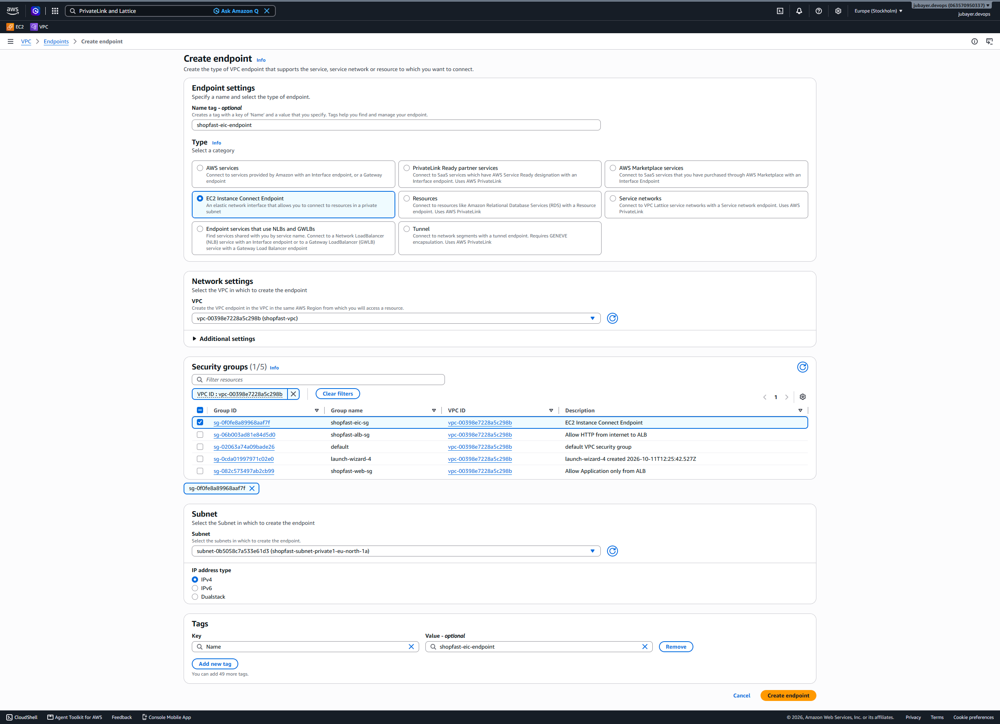
*Fig 24 – Creating the EC2 Instance Connect Endpoint.*

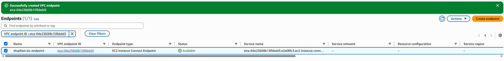
*Fig 25 – `eice-04e23600b15fbbdd3` is Available.*

**Connecting:** EC2 → select instance → *Connect* → tab *EC2 Instance Connect* → card **EC2 Instance Connect Endpoint** (private subnet access) → endpoint `eice-04e23600b15fbbdd3` → username **`ubuntu`** → *Connect*. A terminal opens in the browser.

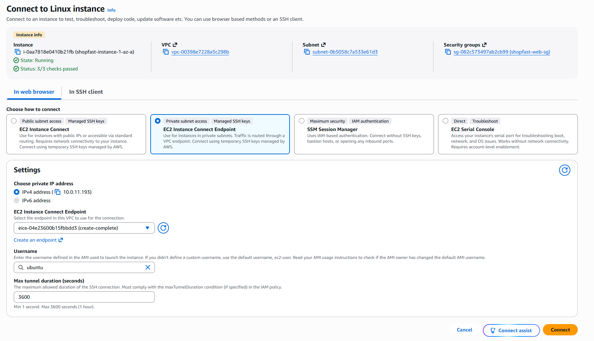
*Fig 26 – Connect settings for Instance 1 (private IP 10.0.11.193).*

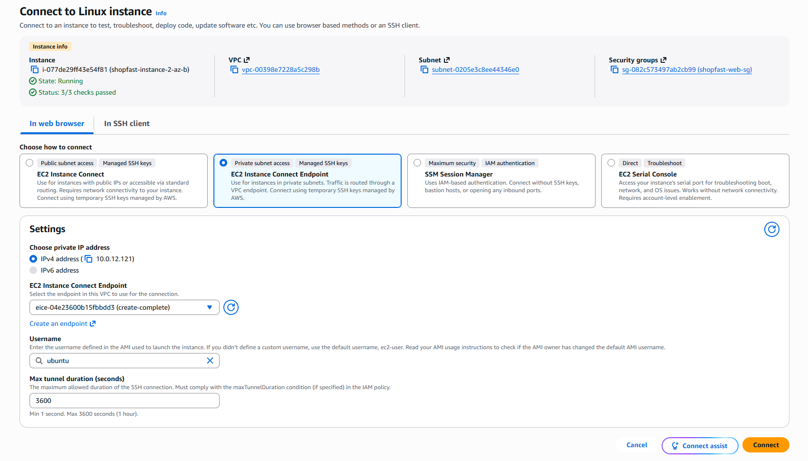
*Fig 27 – Connect settings for Instance 2 (private IP 10.0.12.121).*

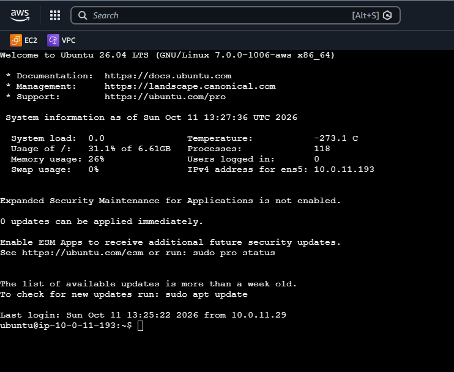
*Fig 28 – Logged in to Instance 1: `ubuntu@ip-10-0-11-193`.*

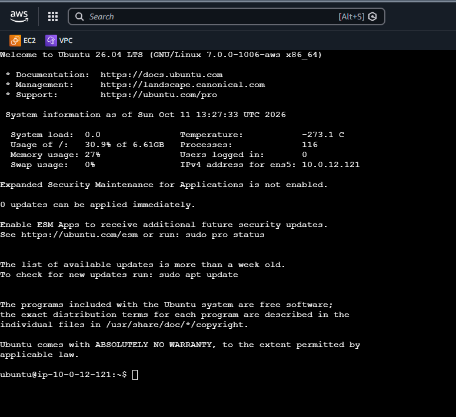
*Fig 29 – Logged in to Instance 2: `ubuntu@ip-10-0-12-121`.*

### Step 6 – Install the Django application (Problem 2)

These commands were run **in both terminals**. The only difference between the servers is the two `Environment=` lines in the service file.

**6.1 Install Python tools**
```bash
sudo apt update && sudo apt install -y python3-venv python3-pip
```

**6.2 Create the project, virtual environment and app**
```bash
mkdir -p ~/shopfast && cd ~/shopfast
python3 -m venv venv              # isolated Python environment
source venv/bin/activate
pip install django gunicorn       # gunicorn = production WSGI server
django-admin startproject config .
python manage.py startapp web
```

**6.3 Allow any Host header**
```bash
sed -i "s/ALLOWED_HOSTS = \[\]/ALLOWED_HOSTS = ['*']/" config/settings.py
grep ALLOWED_HOSTS config/settings.py      # → ALLOWED_HOSTS = ['*']
```
*Why:* the ALB health checker calls the server using its **private IP** as the host name, and customers use the ALB DNS name. With an empty `ALLOWED_HOSTS`, Django answers `400 Bad Request` and every target shows *unhealthy*.

**6.4 Views and URLs**
```bash
cat > web/views.py <<'EOF'
import os
import socket
from django.http import HttpResponse, JsonResponse

NAME = os.environ.get("INSTANCE_NAME", "unknown")
AZ = os.environ.get("AZ_LABEL", "unknown")


def home(request):
    html = f"""
    <html><body style="font-family:sans-serif;text-align:center;margin-top:80px">
      <h1>ShopFast</h1>
      <h2>{NAME} - {AZ}</h2>
      <p>Hostname: {socket.gethostname()}</p>
    </body></html>"""
    response = HttpResponse(html)
    response["X-Served-By"] = f"{NAME} - {AZ}"
    return response


def health(request):
    return JsonResponse({"status": "healthy", "instance": NAME, "az": AZ})
EOF

cat > config/urls.py <<'EOF'
from django.urls import path
from web import views

urlpatterns = [
    path("", views.home),
    path("health", views.health),
]
EOF
```
- `/` returns a page showing **"Instance 1 - AZ-A"** or **"Instance 2 - AZ-B"** plus the hostname, so it is always visible which server answered.
- `/health` returns `{"status": "healthy", ...}` with HTTP 200. This is the dedicated health endpoint used by the ALB.

**6.5 Run it as a systemd service with gunicorn**
```bash
sudo tee /etc/systemd/system/shopfast.service > /dev/null <<'EOF'
[Unit]
Description=ShopFast Django app (gunicorn)
After=network.target

[Service]
User=ubuntu
WorkingDirectory=/home/ubuntu/shopfast
Environment="INSTANCE_NAME=Instance 1"      # Instance 2 on the AZ-B server
Environment="AZ_LABEL=AZ-A"                 # AZ-B on the AZ-B server
ExecStart=/home/ubuntu/shopfast/venv/bin/gunicorn --bind 0.0.0.0:8000 --workers 2 --access-logfile - config.wsgi:application
Restart=always

[Install]
WantedBy=multi-user.target
EOF

sudo systemctl daemon-reload
sudo systemctl enable --now shopfast      # start now AND on every boot
```
*Why systemd:* during test T5 the instance is stopped and started again. Because the service is `enabled`, gunicorn starts by itself on boot and the instance rejoins the load balancer with no manual action.

`--bind 0.0.0.0:8000` listens on all network interfaces. With `127.0.0.1` the ALB could not reach it.

**6.6 Verify on each server**
```bash
curl -s http://localhost:8000/ | grep h2     # which instance am I?
sudo systemctl is-active shopfast            # → active
sudo ss -tlnp | grep 8000                    # → LISTEN 0.0.0.0:8000 gunicorn
curl -s http://localhost:8000/health; echo   # → {"status": "healthy", ...}
```

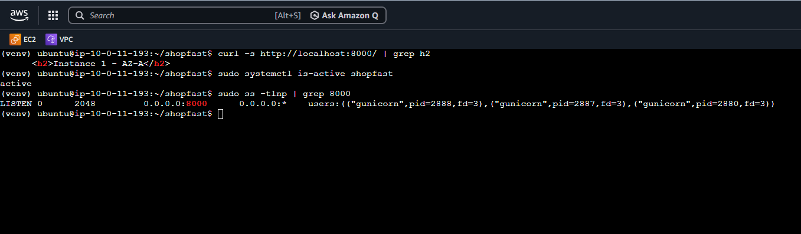
*Fig 30 – Instance 1: page shows `Instance 1 - AZ-A`, service active, gunicorn listening on 0.0.0.0:8000.*

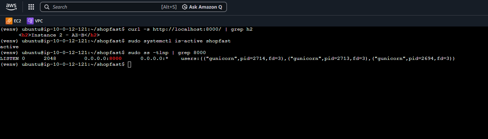
*Fig 31 – Instance 2: service active and listening on 8000. The page showed `Instance - AZ-B` here because of a typo in the service file; it was fixed to `Instance 2` (see [Troubleshooting](#8-troubleshooting-notes)). Later screenshots show the corrected name.*

**6.7 Remove the NAT gateway** (installation is finished, so the servers no longer need internet)
1. VPC → NAT gateways → `shopfast-nat-gateway` → *Actions → Delete NAT gateway*
2. VPC → Route tables → both private tables → *Edit routes* → remove `0.0.0.0/0`
3. VPC → Elastic IPs → `13.50.255.219` → *Release*

The servers are now fully private again, with no route to or from the internet. The ALB reaches them over the VPC's private network.

### Step 7 – Target group and health check

**Console path:** EC2 → Load Balancing → Target Groups → *Create target group*

| Setting | Value |
|---|---|
| Target type | Instances |
| Name | `shopfast-tg` |
| Protocol : Port | HTTP : **8000** |
| VPC | `shopfast-vpc` |
| Protocol version | HTTP1 |
| Health check protocol / path | HTTP · **`/health`** |
| Health check port | Traffic port (8000) |
| Healthy threshold | **2** |
| Unhealthy threshold | **2** |
| Timeout | **5 s** |
| Interval | **10 s** |
| Success codes | **200** |
| Registered targets | `i-0aa7818e0410b21fb` :8000, `i-077de29ff43e54f81` :8000 |

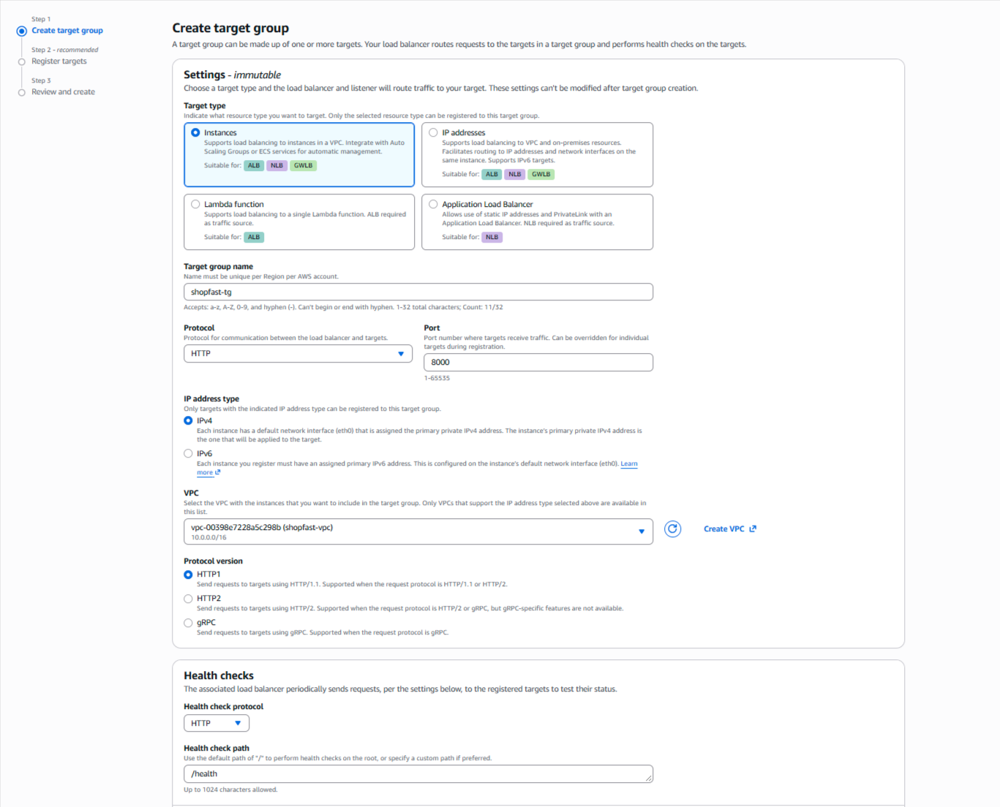
*Fig 32 – Target group settings: Instances, HTTP 8000, shopfast-vpc, health check path `/health`.*

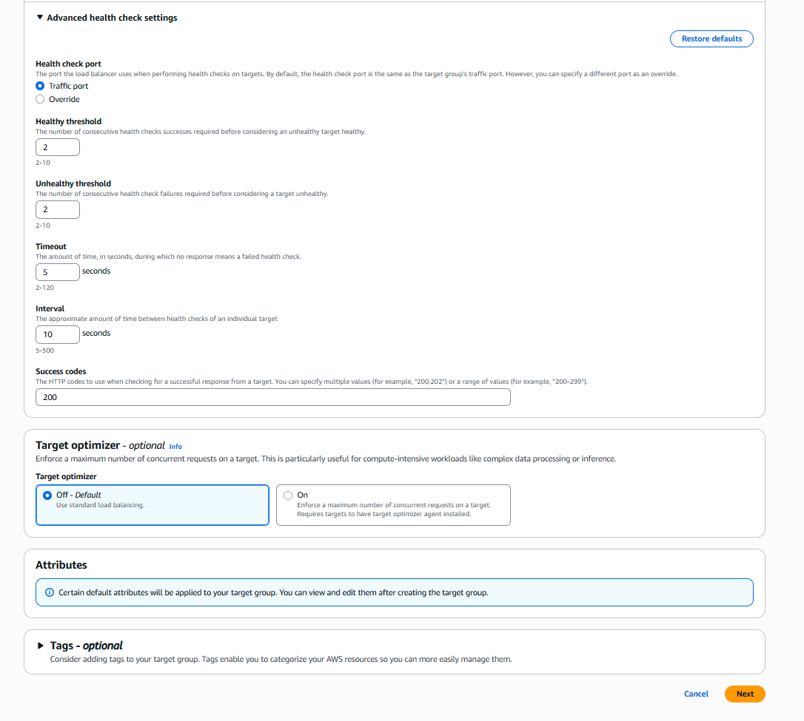
*Fig 33 – Advanced health check settings: thresholds 2/2, timeout 5 s, interval 10 s, success code 200.*

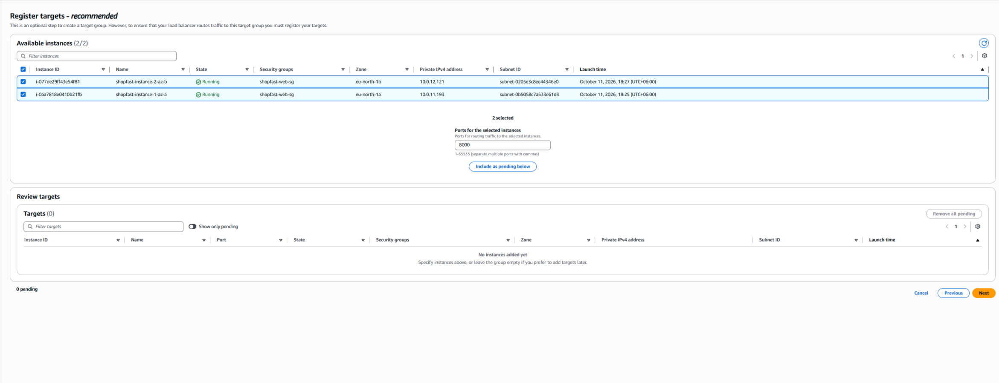
*Fig 34 – Register targets: select both instances, port 8000.*

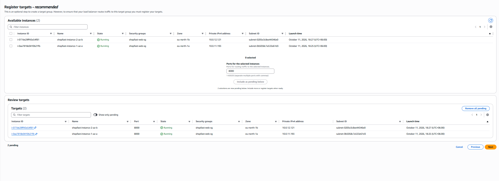
*Fig 35 – Both instances added as pending targets.*

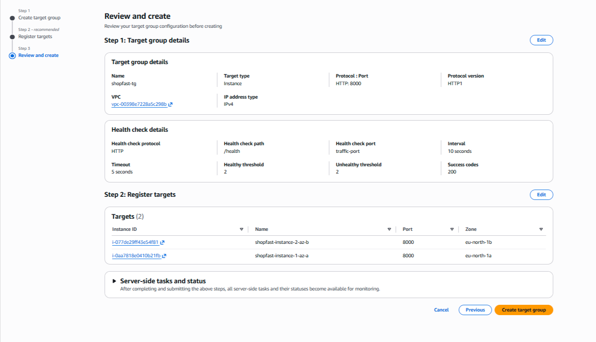
*Fig 36 – Review page with all settings.*

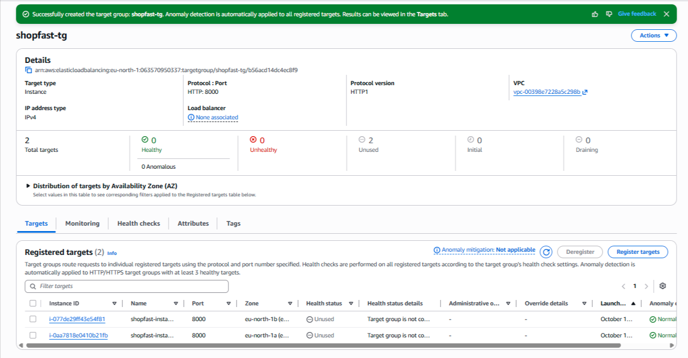
*Fig 37 – Target group created. Targets show **Unused** because no load balancer is attached yet. This is expected.*

### Step 8 – Application Load Balancer (Problem 3)

**Console path:** EC2 → Load Balancers → *Create load balancer* → **Application Load Balancer**

| Setting | Value |
|---|---|
| Name | `shopfast-alb` |
| Scheme | **Internet-facing** |
| IP address type | IPv4 |
| VPC | `shopfast-vpc` |
| AZ & subnets | `eu-north-1a` → **public1** · `eu-north-1b` → **public2** |
| Security group | `shopfast-alb-sg` only (default removed) |
| Listener | **HTTP : 80** → Forward to **`shopfast-tg`** (weight 1, 100%) |
| Target group stickiness | **Off** (so requests alternate between instances) |

An internet-facing ALB must be placed in **public** subnets (with an internet gateway route) in **at least two AZs**. Choosing the private subnets gives an error.

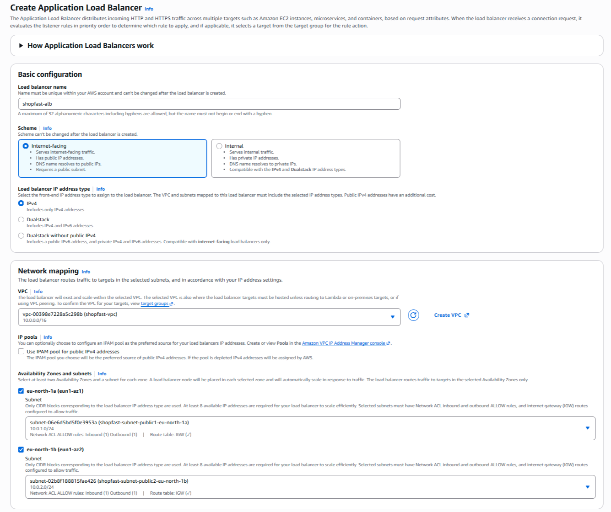
*Fig 38 – ALB basic config and network mapping: internet-facing, both public subnets.*

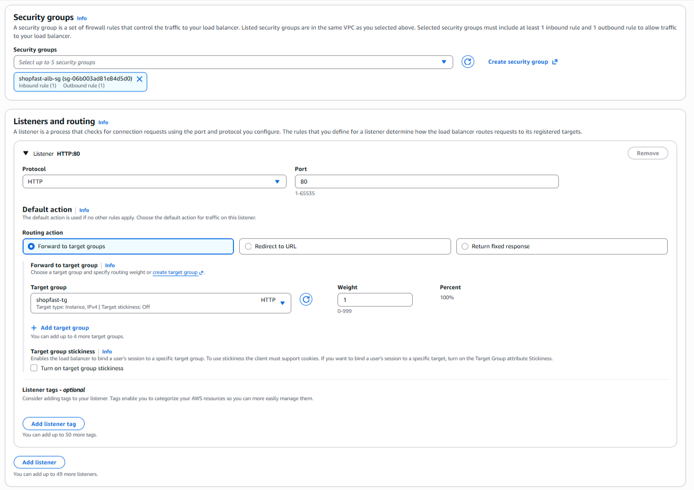
*Fig 39 – Security group `shopfast-alb-sg` and listener HTTP:80 → `shopfast-tg`.*


*Fig 40 – `shopfast-alb` created. DNS name: `shopfast-alb-509413098.eu-north-1.elb.amazonaws.com`.*

How the requirements of Problem 3 are met:

| Requirement | How |
|---|---|
| Load balancer is the only entry point | Instances are in private subnets with no public IP; port 8000 only opens to `shopfast-alb-sg`. |
| Requests distributed across both instances | Listener forwards to one target group containing both instances. Algorithm: *round robin*, stickiness off. |
| Visible which instance served each request | Page body shows `Instance N - AZ-X` + hostname; the `X-Served-By` response header shows the same. |

---

## 4. Health checks (Problem 4)

### 4.1 How removal and recovery work

```
 every 10 s the ALB sends:   GET http://<instance-private-ip>:8000/health

  HEALTHY ──(2 failures in a row)──▶ UNHEALTHY   → ALB stops sending traffic to it
 UNHEALTHY ──(2 successes in a row)──▶ HEALTHY   → ALB automatically adds it back
```

A health check **fails** when the response is not `200`, the TCP connection is refused, or there is no answer within 5 s.

### 4.2 (c) Values chosen and justification

| Setting | Value | Justification |
|---|---|---|
| **Path** | `/health` | A dedicated, lightweight endpoint that only returns `{"status":"healthy"}`. It goes through the full stack (gunicorn → Django → view), so it proves the *application* works, not just that the port is open. It is separate from `/`, so the home page can change without breaking health checks. |
| **Port** | traffic port (8000) | Checks exactly the port that serves customers. |
| **Interval** | **10 s** | Default is 30 s, which would take 60–90 s to notice a dead server, far too long for an e-commerce sale. 10 s detects failures quickly while sending only 6 small requests per minute per instance. (5 s is the minimum; it halves detection time but doubles health-check traffic.) |
| **Timeout** | **5 s** | `/health` normally answers in about 2 ms (*Target Response Time* graph). 5 s leaves plenty of room for a slow moment without hanging too long on a dead server. It must be smaller than the interval. |
| **Unhealthy threshold** | **2** | Two failures in a row (≈20 s) before removal. One failure could be a network blip; two is a reliable signal while still reacting fast. The default 2 already matches this goal. |
| **Healthy threshold** | **2** | A recovered server must pass twice (≈20 s) before receiving customers, which avoids "flapping" (an instance repeatedly joining and leaving while it is still starting up). The AWS default is 5 (≈50 s with a 10 s interval), which delays recovery unnecessarily. |
| **Success codes** | `200` | `/health` returns exactly 200 when healthy. Accepting a range like `200-399` could hide a broken app that redirects. |

**Expected detection time:** 2 × 10 s interval (+ up to 5 s timeout) ≈ **20–25 s**. Test T4 measured about **22 s**, which matches.

### 4.3 (d) Active vs passive health checks

| | **Active health checks** | **Passive health checks** |
|---|---|---|
| How | The load balancer **sends its own probe requests** (e.g. `GET /health`) on a fixed schedule, even with no customer traffic. | The load balancer **watches real customer requests**. If they fail (connection refused, timeouts, 5xx), the server is marked bad. |
| Detects failure | Before customers hit it, including on idle servers. | Only after real requests have already failed. |
| Extra traffic | Yes, small and constant. | None. |
| Recovery | Automatic: the probe keeps checking and re-adds the server when it passes again. | Usually time-based: the server is retried after a cool-off period. |
| Examples | AWS ALB target group health checks, HAProxy `option httpchk`, NGINX Plus `health_check`. | Open-source NGINX `max_fails` / `fail_timeout`. |

**Which does my load balancer use?** The **AWS Application Load Balancer uses active health checks**: it probes `GET /health` on every target every 10 s according to the target group settings. (AWS also offers *anomaly detection / automatic target weights*, a passive-style feature that watches real responses; it shows "Normal" in the screenshots but is not used for removal here.) Open-source NGINX (Option B) only has passive checks built in, which is one of the main differences between the two options.

### 4.4 "Users must not receive error pages"

After an instance is marked unhealthy, **every** request goes to the healthy instance with no errors (proven in T4). During the short **detection window** (≈20 s) before the ALB notices a sudden failure, a few requests that still go to the dying instance can fail, because the ALB does not retry them. Ways to reduce this in production:
- **Planned maintenance:** *deregister* the target first. The ALB drains it (deregistration delay) and **zero** requests fail.
- Shorter interval (5 s) → about half the detection window.
- Client/front-end retries for idempotent GET requests (e.g. CloudFront origin retry).
- More instances per AZ (Auto Scaling) so a single failure affects a smaller share of traffic.

---

## 5. Failure testing and proof of work (Problem 5)

All curl tests were run from **AWS CloudShell** (`>_` icon in the console).
ALB address: `http://shopfast-alb-509413098.eu-north-1.elb.amazonaws.com`

| Test | Steps | Expected | Result |
|---|---|---|---|
| **T1** Health status | ALB details + target group | Both healthy | ✅ ALB Active, **2 Healthy / 0 Unhealthy** |
| **T2** Load distribution | 10 requests with curl | Responses from both | ✅ **5 × Instance 1 / 5 × Instance 2** |
| **T3** Browser test | Open ALB DNS, refresh | Page changes | ✅ Alternates between Instance 1 – AZ-A and Instance 2 – AZ-B |
| **T4** AZ failure | Stop Instance 1 (AZ-A) | AZ-A unhealthy, all traffic to AZ-B | ✅ Detected in ≈22 s, then 100% `200 Instance 2 - AZ-B` |
| **T5** Recovery | Start Instance 1 again | Healthy again, shared automatically | ✅ Rejoined with no manual action, traffic shared again |
| **T6** Monitoring | Target group *Monitoring* tab | Requests to both visible | ✅ Requests, 2XX, healthy-host and connection-error graphs |

### T1 – Health status

**Steps:** EC2 → Load Balancers → `shopfast-alb` (status), then Target Groups → `shopfast-tg`.

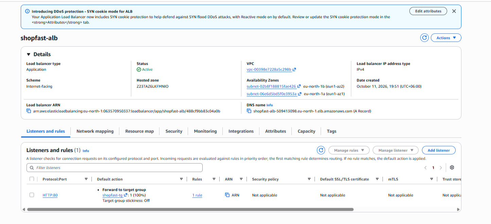
*Fig 41 – `shopfast-alb` is **Active**, internet-facing, in both AZs, listener HTTP:80 → `shopfast-tg` (100%), stickiness Off.*

The target group summary at the top of [Fig 47](#t6--logs--monitoring) shows **Total targets 2 · Healthy 2 · Unhealthy 0**: both instances pass the `/health` check.

### T2 – Load distribution

**Command:**
```bash
ALB=http://shopfast-alb-509413098.eu-north-1.elb.amazonaws.com
for i in $(seq 1 10); do
  echo -n "Request $i: "
  curl -s $ALB/ | grep -o 'Instance [12] - AZ-[AB]'
done
```

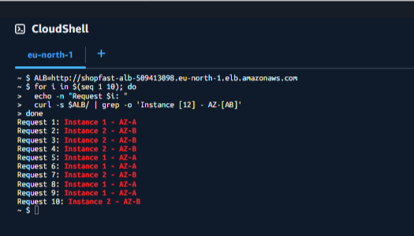
*Fig 42 – 10 requests: Instance 1 – AZ-A answered 5 (requests 1, 5, 6, 8, 9) and Instance 2 – AZ-B answered 5 (2, 3, 4, 7, 10).*

**Explanation:** traffic is split 50/50. The order is not strictly A-B-A-B because the ALB has **two nodes** (one per AZ). DNS returns both node IPs, and each node does its own round robin, so the combined sequence looks mixed, but the overall share is even.

### T3 – Browser test

**Steps:** open `http://shopfast-alb-509413098.eu-north-1.elb.amazonaws.com` in an incognito window and press **Ctrl + F5** several times. Use `http://`, since there is no HTTPS listener.


*Fig 43 – Browser served by **Instance 1 - AZ-A** (hostname `ip-10-0-11-193`).*

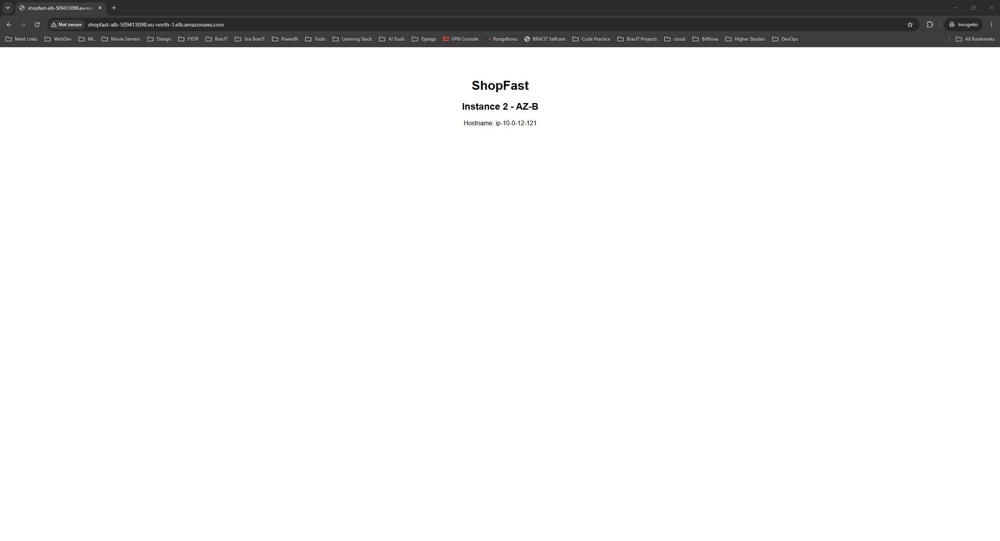
*Fig 44 – After refresh: **Instance 2 - AZ-B** (hostname `ip-10-0-12-121`). Same URL, different server.*

### T4 – AZ failure

**Steps:**
1. Start the live monitor in CloudShell:
   ```bash
   ALB=http://shopfast-alb-509413098.eu-north-1.elb.amazonaws.com
   while true; do
     r=$(curl -s -m 3 -w '\n%{http_code}' $ALB/)
     code=$(echo "$r" | tail -1)
     who=$(echo "$r" | grep -o 'Instance [12] - AZ-[AB]')
     echo "$(date +%T)  HTTP $code  $who"
     sleep 1
   done
   ```
2. EC2 → Instances → `shopfast-instance-1-az-a` → **Instance state → Stop instance**.
3. Watch the monitor and the target group *Targets* tab.

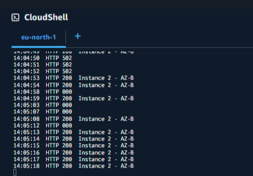
*Fig 45 – Failover timeline while Instance 1 (AZ-A) shuts down.*

**Reading the result (times in UTC):**

| Time | Output | Meaning |
|---|---|---|
| 14:04:49 | `HTTP 200 Instance 2 - AZ-B` | normal traffic |
| 14:04:50 – 52 | `HTTP 502` × 3 | Instance 1 is shutting down; gunicorn refuses connections, but the ALB has not detected it yet, so it returns *502 Bad Gateway* |
| 14:04:53 – 14:05:12 | `200 Instance 2` mixed with `HTTP 000` × 4 | `000` = curl's own 3 s timeout: the instance is off and the ALB's connection to it hangs. Meanwhile health checks are failing. |
| **14:05:13 →** | **`HTTP 200 Instance 2 - AZ-B` on every request** | Instance 1 marked **unhealthy** and removed. **Zero errors from here on.** |

**Conclusion:** the ALB automatically removed the failed AZ-A instance in about **22 seconds** (2 failed checks × 10 s interval + timeout), exactly as the health-check settings predict. After that, all requests were served by AZ-B with no errors. The short error window is the detection time discussed in [4.4](#44-users-must-not-receive-error-pages). The CloudWatch *Target connection errors* graph (Fig 47) shows the same 4 connection failures from the ALB's side.

### T5 – Recovery

**Steps:** keep the monitor running → EC2 → `shopfast-instance-1-az-a` → **Instance state → Start instance**. Nothing else is done manually.

What happens: the instance boots (≈1 min) → systemd starts gunicorn automatically → the ALB's `/health` checks succeed twice (≈20 s) → the target becomes **healthy** → traffic is shared again.

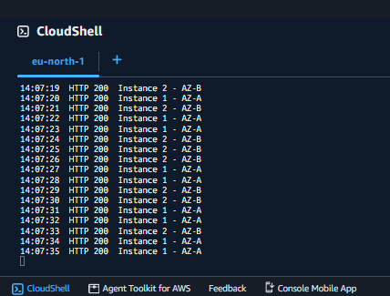
*Fig 46 – After the restart, responses alternate between **Instance 1 - AZ-A** and **Instance 2 - AZ-B** again, all `HTTP 200`.*

### T6 – Logs / monitoring

**Steps:** EC2 → Target Groups → `shopfast-tg` → **Monitoring** tab (CloudWatch metrics, time range 3 h).

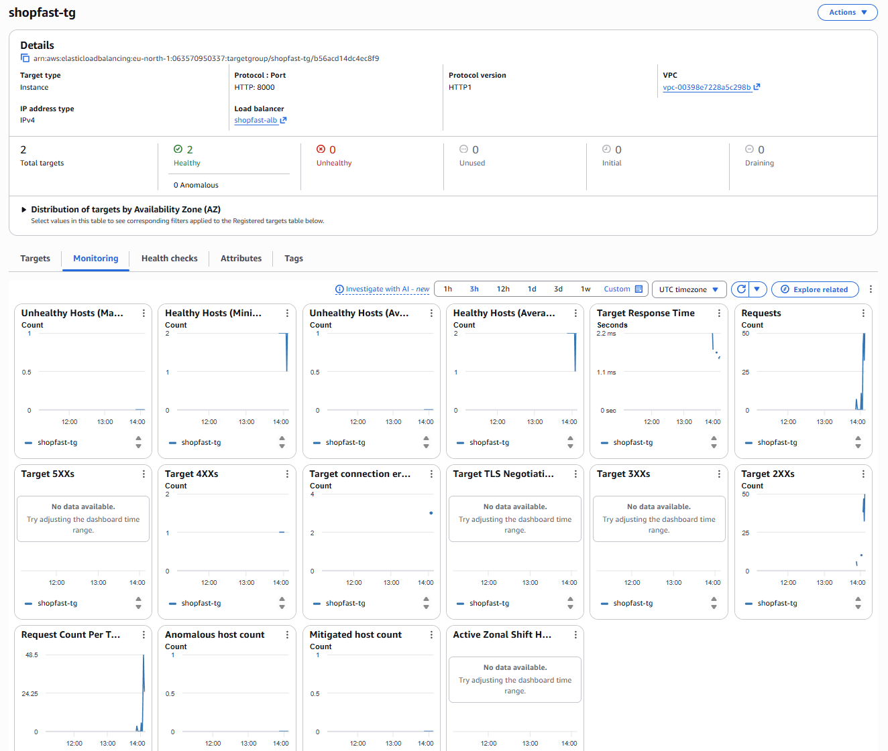
*Fig 47 – Target group monitoring: 2 healthy / 0 unhealthy targets now; Requests and Target 2XX spikes from the tests; Target Response Time ≈ 2 ms; Target connection errors = 4 (the T4 failover window); Healthy Hosts graph shows the dip and recovery.*

| Metric | What it proves |
|---|---|
| **Requests / Request count per target** | Traffic reached the targets through the ALB (about 50 requests at peak). |
| **Target 2XX** | Requests were served successfully by the instances. |
| **Healthy / Unhealthy hosts** | Health state over time, including the T4 removal and the T5 recovery. |
| **Target connection errors (4)** | The ALB's view of the failover window in T4. |
| **Target response time ≈ 2 ms** | Why a 5 s health-check timeout is generous. |

**Extra: per-instance access logs.** gunicorn writes an access log line for every request (`--access-logfile -`) into the systemd journal. On each instance (via the EIC endpoint):
```bash
sudo journalctl -u shopfast -n 15 --no-pager
```
Lines look like `10.0.1.x - - [...] "GET /health HTTP/1.1" 200` and `"GET / HTTP/1.1" 200`. The source IPs are `10.0.1.x` / `10.0.2.x`, the ALB's private addresses in the public subnets. This proves requests reach **both** instances and **only through the ALB**.

---

## 6. Reflection (Problem 6)

### 6.1 AWS ALB vs NGINX – advantages and limitations

The **AWS Application Load Balancer** is a managed service. AWS runs it across several Availability Zones, scales it automatically with traffic, patches it, and integrates it with target groups, active health checks, CloudWatch metrics, Auto Scaling, ACM certificates and WAF. I configured everything from the console in minutes and never managed a load-balancer server. Its limitations are cost (it is billed per hour plus usage, and the NAT gateway I needed was also paid), vendor lock-in, and less low-level control: for example, the ALB does not retry a failed request, and advanced behaviour must fit what AWS exposes.

**NGINX (Option B)** is free, open-source and runs anywhere: laptop, on-premises, or any cloud. It gives full control over configuration (custom routing, caching, rewrites, retries with `proxy_next_upstream`) and is great for learning because every piece is visible. However, I would have to run, patch, monitor and scale the NGINX server myself, and make NGINX itself highly available. Open-source NGINX also only supports **passive** health checks (`max_fails`/`fail_timeout`); active checks require NGINX Plus or extra tooling. For ShopFast, which has a small team and needs reliability, the managed ALB is the better choice. NGINX fits teams that need portability or special logic.

### 6.2 What if the load balancer itself failed?

If the load balancer were a single machine, it would become the new **single point of failure**: both web servers could be healthy, but no customer could reach them, exactly the outage ShopFast wants to avoid. Production systems remove this risk with redundancy at the load-balancer layer. An AWS ALB is not one server. It is a fleet of nodes that AWS runs in **every AZ I selected** (eu-north-1a and eu-north-1b), behind one DNS name that returns several IP addresses. If a node or a whole AZ fails, Route 53 health checks remove that node's IP from DNS and the other AZ continues serving, while AWS replaces failed nodes automatically.

For even higher resilience, companies run load balancers in **multiple regions** and use **Route 53 failover or latency routing**, or put a global layer such as **CloudFront** or **AWS Global Accelerator** in front. In self-managed setups like NGINX, the usual pattern is two load balancers in an **active–passive pair** sharing a floating/virtual IP with **keepalived (VRRP)**, or several active load balancers behind DNS round robin. The principle is always the same: no layer should depend on a single machine.

### 6.3 A problem I faced and how I solved it

The hardest problem was security groups that **silently belonged to the wrong VPC**. When I created `shopfast-web-sg`, the console pre-selected the **default VPC** (`vpc-0b6f6d8370adc5d87`). Because of that, `shopfast-alb-sg` did not appear in the Source dropdown. When I pasted its ID manually, creation failed with *"You have specified two resources that belong to different networks"* and AWS rolled the group back. I solved it by switching the VPC dropdown to `shopfast-vpc` **before** filling in anything else. After that, the ALB security group appeared and the rule saved correctly. The same issue then appeared when launching instances: they received `default` and `launch-wizard-4` security groups instead of `shopfast-web-sg`. Rather than relaunching, I used *Actions → Security → Change security groups* to attach the correct group.

A second problem was that the private servers had **no internet**, so `pip install django` was impossible. I added a **temporary NAT gateway** plus routes, installed the packages, then deleted the NAT and released its Elastic IP to keep the servers private and the cost low. I also caught a small typo (`Instance - AZ-B`) by testing locally with `curl` before attaching the ALB. **Lesson:** always check the VPC field first, and verify each layer before building the next.

---

## 7. Resource ID reference

| Resource | Name | ID / value |
|---|---|---|
| VPC | shopfast-vpc | `vpc-00398e7228a5c298b` |
| ALB | shopfast-alb | DNS `shopfast-alb-509413098.eu-north-1.elb.amazonaws.com` |
| Target group | shopfast-tg | HTTP:8000, health `/health` |
| Instance 1 (AZ-A) | shopfast-instance-1-az-a | `i-0aa7818e0410b21fb` · 10.0.11.193 · eu-north-1a |
| Instance 2 (AZ-B) | shopfast-instance-2-az-b | `i-077de29ff43e54f81` · 10.0.12.121 · eu-north-1b |
| SG – ALB | shopfast-alb-sg | `sg-06b003ad81e84d5d0` |
| SG – web | shopfast-web-sg | `sg-082c573497ab2cb99` |
| SG – EIC | shopfast-eic-sg | `sg-0f0fe8a89968aaf7f` |
| EIC endpoint | shopfast-eic-endpoint | `eice-04e23600b15fbbdd3` |
| S3 gateway endpoint | – | `vpce-0a87409469cac8dec` |
| NAT gateway (temporary) | shopfast-nat-gateway | `nat-01a264863ccd940e7` · EIP 13.50.255.219 |

---

## 8. Troubleshooting notes

Problems hit during the build and their fixes (useful when repeating this later):

| Symptom | Cause | Fix |
|---|---|---|
| `shopfast-alb-sg` missing from the Source dropdown | Form was using the **default VPC** | Change the VPC dropdown to `shopfast-vpc` first. |
| *"You have specified two resources that belong to different networks"* | Security group and its source SG were in different VPCs | Same as above; the SG is rolled back, just retry with the right VPC. |
| *"CIDR block, a security group ID or a prefix list has to be specified"* | Typed `sg` and pressed Enter in the Source box | Click the box and **pick** the group from the list. |
| Instances launched with `default` / `launch-wizard-4` SG | "Select existing security group" not set in the launch wizard | *Actions → Security → Change security groups* (no relaunch needed). |
| "No public IPv4 address assigned" on Connect | Used the *EC2 Instance Connect* (public) card | Choose the **EC2 Instance Connect Endpoint** card; username `ubuntu` for Ubuntu AMIs. |
| Endpoint dropdown empty / "no endpoint available" | EIC endpoint not created yet (the S3 endpoint is a different type) | VPC → Endpoints → Create → type **EC2 Instance Connect Endpoint**. |
| `pip install` fails on private servers | No internet route | Temporary NAT gateway in a public subnet + `0.0.0.0/0 → NAT` route; delete afterwards. |
| Page shows `Instance - AZ-B` | Typo in `Environment="INSTANCE_NAME=..."` | Edit the service file → `sudo systemctl daemon-reload && sudo systemctl restart shopfast`. |
| Targets *Unused* | Target group not attached to a load balancer yet | Create the ALB with a listener forwarding to the group. |
| Targets *unhealthy* (common causes) | Wrong port, SG not allowing ALB, `ALLOWED_HOSTS` empty (400), app bound to 127.0.0.1 | Check `ss -tlnp`, SG rule 8000 ← alb-sg, `ALLOWED_HOSTS = ['*']`, `--bind 0.0.0.0:8000`. |
| `HTTP 502` / `000` for ~20 s in T4 | Detection window before the target is marked unhealthy | Expected; deregister first for planned maintenance, or lower the interval. |

Handy commands on an instance:
```bash
sudo systemctl status shopfast --no-pager     # is the app running?
sudo journalctl -u shopfast -n 30 --no-pager  # app + access logs
sudo ss -tlnp | grep 8000                     # who listens on 8000?
curl -s localhost:8000/health                 # local health test
```

---

## 9. Cleanup

Deleted in this order after collecting all screenshots, to avoid charges:

1. **Load balancer** `shopfast-alb` – EC2 → Load Balancers → *Actions → Delete*
2. **Target group** `shopfast-tg` – EC2 → Target Groups → *Actions → Delete*
3. **EC2 instances** – both `shopfast-instance-*` → *Instance state → Terminate*
4. **NAT gateway** `shopfast-nat-gateway` (if not already deleted) and **Elastic IP** 13.50.255.219 → *Release*
5. **EC2 Instance Connect Endpoint** `shopfast-eic-endpoint` – VPC → Endpoints → *Delete*
6. **VPC** `shopfast-vpc` – VPC → *Actions → Delete VPC* (also removes subnets, route tables, IGW, S3 endpoint and security groups)
7. Final check: VPC dashboard → NAT gateways = 0, Elastic IPs not attached = 0, EC2 → Load balancers = 0

---

*"In DevOps, if it is not documented and proven, it did not happen."*
